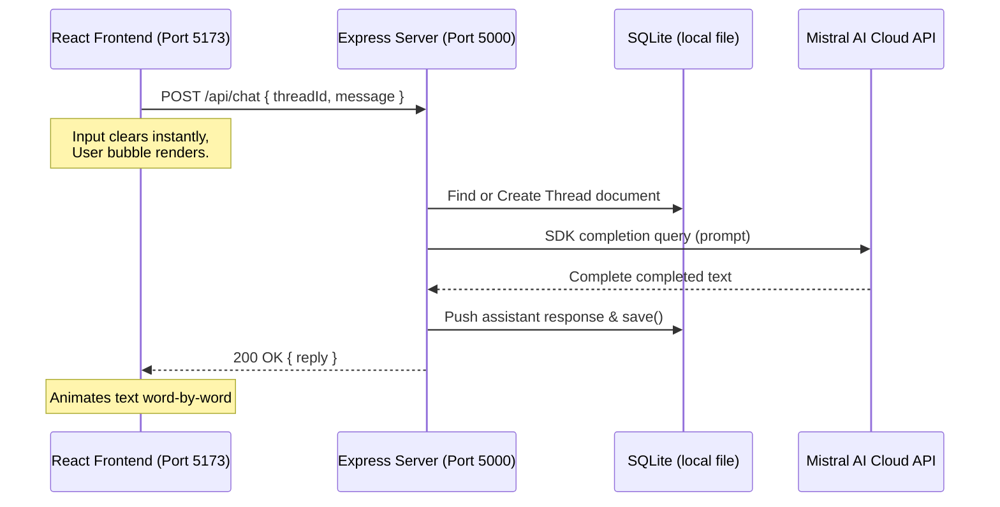

# 🌌 SigmaGPT

🤖 **A State-of-the-Art Full-Stack AI Chat Application powered by React, Express, SQLite, and the Mistral API.**

---

[](https://nodejs.org/)
[](https://expressjs.com/)
[](https://react.dev/)
[](https://vite.dev/)
[](https://www.sqlite.org/)
[](https://mistral.ai/)
[](https://opensource.org/licenses/MIT)

---

## 📌 Table of Contents
* [1. Overview](#1-overview)
* [2. Features](#2-features)
* [3. Tech Stack](#3-tech-stack)
* [4. Architecture](#4-architecture)
* [5. Project Structure](#5-project-structure)
* [6. Database Design](#6-database-design)
* [7. API Flow](#7-api-flow)
* [8. Installation Guide](#8-installation-guide)
* [9. Environment Variables](#9-environment-variables)
* [10. Challenges Faced](#10-challenges-faced)
* [11. Key Learnings](#11-key-learnings)
* [12. Performance & Security](#12-performance--security)
* [13. Future Enhancements](#13-future-enhancements)
* [14. Deployment](#14-deployment)
* [15. Resume Impact](#15-resume-impact)
* [16. Contributing](#16-contributing)
* [17. License](#17-license)
* [18. Author](#18-author)

---

## 1. Overview

**SigmaGPT** is a production-grade, highly responsive full-stack conversational workspace clone of ChatGPT. The application decouples static frontend UI layers from backend logic gateways, housing conversation histories natively inside document-based Mongo database records. 

### Why it was built
SigmaGPT was developed to demonstrate best practices in full-stack architecture, including:
1. Modular separation of concerns.
2. Optimized NoSQL schema modeling (embedded subdocuments vs. separate references).
3. Secure integration of LLM SDK gateways (isolating access tokens on the server).
4. Interactive UX concepts like immediate state updates (optimistic rendering) and typing animations.

---

## 2. Features

* **⚡ Optimistic User Input Reflow**: The user prompt is rendered on the screen instantly upon submission, clearing the input area immediately to maximize UI responsiveness.
* **✍️ Simulated Word-by-Word Typing**: Assistant replies animate word-by-word via interval-based loops, mirroring a premium streaming interaction.
* **📚 Thread History CRUD Management**: Users can create conversations, retrieve past threads instantly via the sidebar, and delete threads without page refreshes.
* **🎨 Markdown & Code Highlights**: Chat bubbles support full markdown formatting, including automatic code block syntax highlighting powered by `rehype-highlight` and `github-dark` styles.
* **🔒 Isolated API Architecture**: AI model keys are protected on the backend using `dotenv`, shielding secrets from frontend compilation.
* **⚙️ Database Automatic Syncing**: Every text completion updates thread histories and timestamps automatically.

---

## 3. Screenshots

```
+--------------------------------------------------------+
|  [+] New Chat         |  SigmaGPT  v1.0            (⚙️) |
|                       +--------------------------------+
|  - How does CORS w..  |                                |
|  - Explain systems    |  🧑 User: What is Node?        |
|  - Testing Thread     |                                |
|                       |  🤖 SigmaGPT: Node.js is an    |
|                       |     asynchronous event-driven  |
|                       |     JS runtime engine...       |
|                       +--------------------------------+
|  By Subham Tomar      |  [ Ask anything         ] (🚀) |
+--------------------------------------------------------+
```
*(Place actual screenshots here inside your GitHub repository)*

---

## 4. Tech Stack

### Frontend
* **React 19 (SPA)**: Renders declarative, reactive state components.
* **Vite**: Provides lightning-fast compilation and Hot Module Replacement (HMR).
* **React Context API**: Distributes states globally across components, avoiding prop-drilling.
* **React Markdown & Rehype-Highlight**: Renders styled markdown and handles programming syntax highlighting.

### Backend
* **Node.js (ES Modules)**: Enables non-blocking event-driven JavaScript server environments.
* **Express.js**: Minimalist framework that exposes clean, modular REST API routing controllers.
* **SQLite**: Provides a temporary local database without requiring a separate database service.

### Database
* **SQLite**: Stores thread records and serialized message histories in a local file.

### AI Integration
* **Mistral AI SDK**: Interfaces securely with Cloud completions models (`mistral-large-latest`).

---

## 5. Architecture

### System Flow Diagram


### Key Flow Details
* **Frontend Address**: `http://localhost:5173`
* **API Gateway Address**: `http://localhost:5000` (Moved from port `8080` to prevent conflicts with local Oracle Database engines).
* **Database Connection**: `Backend/data/sigmagpt.sqlite` (created automatically on first request).

---

## 6. Project Structure

```text
SigmaGPT/
│
├── Backend/
   │   ├── utils/
   │   │   └── database.js          # SQLite connection and schema initialization
│   ├── routes/
│   │   └── chat.js               # REST API route controllers
│   ├── utils/
│   │   └── mistral.js            # Mistral API configuration and SDK wrappers
│   ├── .env                      # Protected environment configurations
│   ├── server.js                 # Entry point of the Express API server
│   └── package.json              # Backend dependencies and type configs
│
└── Frontend/
    ├── public/                   # Static assets
    ├── src/
    │   ├── assets/
    │   │   └── blacklogo.png     # Brand logos
    │   ├── App.css               # Core styling overrides
    │   ├── App.jsx               # State coordinator & Context provider
    │   ├── Chat.css              # Message bubble CSS
    │   ├── Chat.jsx              # Markdown & Typing animation logic
    │   ├── ChatWindow.css        # Main window frame styling
    │   ├── ChatWindow.jsx        # Main messaging inputs & loaders
    │   ├── MyContext.jsx         # Context definition
    │   ├── Sidebar.css           # Sidebar list styling
    │   ├── Sidebar.jsx           # Thread selector & CRUD hooks
    │   ├── index.css             # Root variables & CSS resets
    │   └── main.jsx              # React app mount script
    ├── eslint.config.js          # ESLint rules configuration
    ├── index.html                # App template
    ├── package.json              # Frontend modules configuration
    └── vite.config.js            # Vite bundler parameters
```

---

## 7. Database Design

SigmaGPT stores each thread in SQLite, with its message history serialized as JSON in the same row. Because chat messages are always scoped to one conversation, this keeps local development simple while preserving the existing API shape.

### Data Model Schema (`Thread`)
```sql
CREATE TABLE threads (
   threadId TEXT PRIMARY KEY,
   title TEXT NOT NULL,
   messages TEXT NOT NULL DEFAULT '[]',
   createdAt TEXT NOT NULL,
   updatedAt TEXT NOT NULL
);
```

---

## 8. API Flow

1. **Client Request**: Frontend triggers `POST /api/chat` passing a JSON payload with `threadId` and the input `message`.
2. **Database Load**: Express router intercepts the call, reads the database, and loads the active `Thread` document. If it is a new chat, it creates a new document.
3. **AI completion**: The backend queries the Mistral API using the Mistral SDK, passing the current prompt.
4. **State Commit**: The response from Mistral is appended to the message array and saved to the local SQLite database.
5. **Response Dispatch**: The Express server sends the AI-generated reply back to the client as JSON:
   ```json
   { "reply": "Mistral generated text response..." }
   ```

---

## 9. Installation Guide

### Prerequisites
Make sure you have [Node.js](https://nodejs.org/) (v18 or higher) installed on your local machine. SQLite is installed through the backend npm dependencies.

### 1. Clone the repository
```bash
git clone https://github.com/yourusername/SigmaGPT.git
cd SigmaGPT
```

### 2. Configure Backend
1. Navigate to the `Backend` directory:
   ```bash
   cd Backend
   ```
2. Install dependencies:
   ```bash
   npm install
   ```
3. Create a `.env` file (see [Environment Variables](#9-environment-variables) below).
4. Start the server in development mode:
   ```bash
   npm run dev
   ```

### 3. Configure Frontend
1. Navigate to the `Frontend` directory in a new terminal window:
   ```bash
   cd ../Frontend
   ```
2. Install dependencies:
   ```bash
   npm install
   ```
3. Start the Vite development server:
   ```bash
   npm run dev
   ```
4. Open your browser and navigate to the printed address (default: `http://localhost:5173`).

---

## 10. Environment Variables

Create a `.env` file inside the `Backend/` directory:

```env
# Server Configuration (Defaults to 5000 if not specified)
PORT=5000

# AI Model Keys (Required)
MISTRAL_API_KEY=your_mistral_api_key_here
```

---

## 11. Challenges Faced

### ⚡ Oracle Database Port Conflict (Port 8080)
* **Problem**: The Express server originally listened on port `8080`. When the React client sent requests, it received `401 Unauthorized` responses containing headers from an `Oracle Database/Oracle XML DB` instance. The user's system was running a background database service that intercepted requests on port 8080.
* **Resolution**: Migrated the Express app listener to port `5000` (allowing fallback overrides via `process.env.PORT`) and updated all frontend fetch endpoints in `ChatWindow.jsx` and `Sidebar.jsx` to target port 5000.

### 🔌 OpenAI to Mistral Migration
* **Problem**: The original backend integration targeted OpenAI endpoints, but the development environment lacked an OpenAI key and instead had a `MISTRAL_API_KEY` defined.
* **Resolution**: Replaced the OpenAI client code with the official `@mistralai/mistralai` SDK, refactored API routes, and created a modular `mistral.js` utility.

### 🧠 ESLint Compilation Warnings
* **Problem**: Unused imports, unused variables, and React hook dependencies (specifically inside `useEffect`) triggered compilation warnings.
* **Resolution**: Moved the `getAllThreads` helper function inside the `useEffect` block in `Sidebar.jsx` and included `setAllThreads` in its dependency array. Unused variables were cleaned up, achieving a **100% clean compilation check**.

---

## 12. Key Learnings

* **NoSQL Embedded Documents vs Relational References**: Embedded subdocument designs are faster for read queries in conversational UIs since all history is fetched in a single DB transaction.
* **Optimistic UI Updates**: Updating the React state array immediately on form submission (instead of waiting for the API call to resolve) makes the application feel significantly more responsive.
* **CORS Policies**: Understood browser pre-flight checks (`OPTIONS` requests) and how to configure Express CORS headers to allow cross-origin requests securely.

---

## 13. Performance & Security

* **API Key Protection**: External credentials (like `MISTRAL_API_KEY`) are kept on the server and are never exposed to the client.
* **Proxy and CORS Isolation**: The frontend only communicates with our local Node API. The backend acts as a secure proxy, routing queries to the Mistral cloud.
* **Input Validation**: The backend checks for missing fields (`!threadId || !message`) before processing requests, preventing empty or corrupt writes.
* **Robust Error Handling**: DB queries and API calls are wrapped in `try...catch` blocks. The server responds with proper HTTP status codes (400, 404, 500) and remains running stably in case of failures.

---

## 14. Future Enhancements

* **🔐 User Authentication**: Add JWT authentication using secure HTTP-only cookies and password hashing (bcrypt).
* **🌊 Real-time Token Streaming**: Refactor REST routes to use Server-Sent Events (SSE) so responses stream token-by-token.
* **📂 Retrieval-Augmented Generation (RAG)**: Integrate a Vector Database (like Pinecone) to allow users to query custom documents.
* **☁️ Cloud Deployments**: Package the backend in a Docker container and deploy it to AWS/Render, and host the frontend static pages on Vercel/CDNs.

---

## 15. Deployment

### Frontend
1. Build the production files:
   ```bash
   npm run build
   ```
2. Deploy the generated `dist/` directory to static hosting services like **Vercel**, **Netlify**, or **GitHub Pages**.

### Backend
1. Configure the `MISTRAL_API_KEY` environment variable in your production hosting platform.
2. Start the server in production mode:
   ```bash
   npm start
   ```
3. Deploy to container services like **Render**, **Heroku**, or **AWS ECS**.

---

## 16. Resume Impact

This project demonstrates strong engineering skills in:
* **Full-Stack Integration**: Connecting a modern SPA (Vite + React) to a Node/Express backend API gateway and a local SQLite database.
* **System Design**: Implementing embedded NoSQL databases, context-driven state propagation, and secure API proxy patterns.
* **Debugging**: Resolving environment conflicts (port overlaps), managing linter compilations, and handling cross-origin access configurations.

---

## 17. Contributing

1. Fork the Project.
2. Create your Feature Branch (`git checkout -b feature/AmazingFeature`).
3. Commit your Changes (`git commit -m 'Add some AmazingFeature'`).
4. Push to the Branch (`git push origin feature/AmazingFeature`).
5. Open a Pull Request.

---

## 18. License

Distributed under the MIT License. See [LICENSE](LICENSE) for more information.

---

## 19. Author

👤 **Subham Tomar**
* GitHub: [@yourusername](https://github.com/yourusername)
* LinkedIn: [@yourprofile](https://linkedin.com/in/yourprofile)
