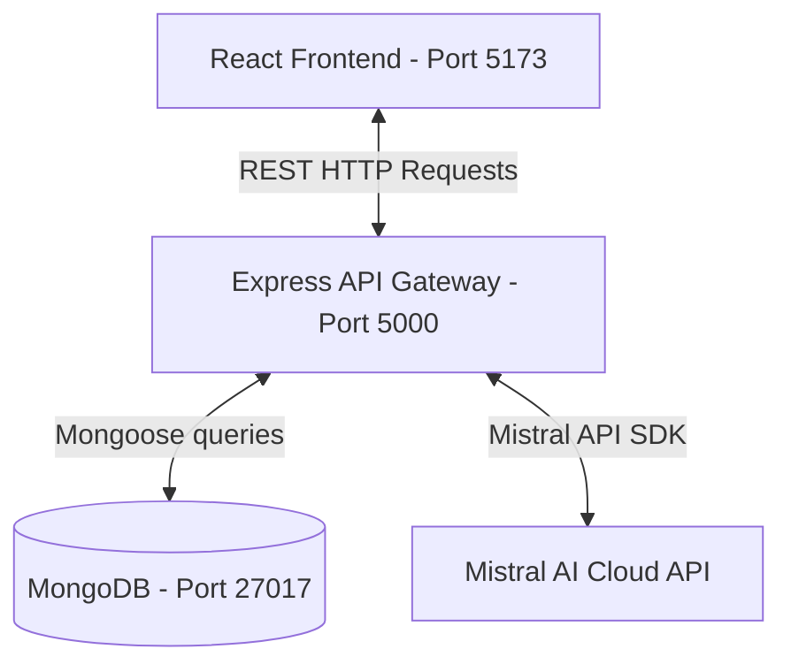

# SigmaGPT: Technical Interview & System Design Guide

This guide is structured to help you master the architectural details, code workflows, tech stack choices, design decisions, and system design patterns of the **SigmaGPT** project for your technical interview.

---

## 1. Project Overview

### What problem does this project solve?
Standard Large Language Model (LLM) interfaces (like ChatGPT) store user queries and system responses inside isolated sessions. Implementing a custom wrapper allows developers to integrate customized chat history persistence, leverage specific model endpoints (such as Mistral AI), control system prompts, and manage user session workflows without relying on third-party user management databases. SigmaGPT solves this by building a lightweight, responsive, and persistent chat clone that saves thread histories locally to a database and coordinates real-time streaming-like UI updates.

### What is the purpose of the project?
The project demonstrates a production-ready, full-stack integration pattern:
1. **Frontend**: A modular, responsive React SPA (Single Page Application) that manages application state via React Context API, performs asynchronous HTTP requests, implements typing indicators, and renders markdown with syntax highlighting.
2. **Backend**: An Express.js microservice structured into separate models, routes, and utilities (modular architecture) that handles thread management CRUD operations and acts as a gateway to external AI APIs.
3. **Database**: A document store (MongoDB) designed to represent nested structures (like a list of chat messages) efficiently.

### Who are the target users?
Target users are developers or teams seeking a lightweight, self-hosted chat interface that runs locally or inside private networks with absolute control over API costs, data privacy, and model backends (using Mistral AI instead of OpenAI to optimize cost-efficiency or open-source deployments).

### What are the key features?
* **Persistent Threads (CRUD)**: Create new chats, fetch thread histories, render threads, and delete threads from a sidebar.
* **Instant UI Reflow**: User questions are displayed immediately on the screen while the network call executes, preventing the interface from feeling frozen.
* **Typing Animation Effect**: Assistant responses are simulated using word-by-word typing intervals to elevate the user experience.
* **Rich Text Support**: Markdown rendering and automatic code syntax highlighting inside the chat bubble via `react-markdown` and `rehype-highlight`.
* **State synchronization**: Context-based global values ensure that selecting or deleting a thread synchronously updates the main viewport and loader status.

---

## 2. Architecture Explanation

### System Architecture Flow
SigmaGPT is designed using a **Client-Server Architecture** utilizing a **Single Page Application (SPA)** front-end, a **RESTful API** gateway, and a **Document Database**.



### 1. Frontend Flow
1. The user inputs a query in [ChatWindow.jsx](file:///d:/SigmaGPT/Frontend/src/ChatWindow.jsx) and presses Enter or clicks Send.
2. The UI instantly appends the query to the `prevChats` state array, clears the text input box, and enables a loading indicator (`ScaleLoader`).
3. An asynchronous HTTP `POST` fetch request is dispatched to the backend.
4. When the response arrives, the assistant message is added to `prevChats`, triggering the typing animation in [Chat.jsx](file:///d:/SigmaGPT/Frontend/src/Chat.jsx) via a `setInterval` hook.

### 2. Backend Flow
1. The Express gateway ([server.js](file:///d:/SigmaGPT/Backend/server.js)) listens on port `5000` (moved from port `8080` to bypass Oracle Database conflicts).
2. It registers parsing middlewares (`express.json()`, `cors()`) and delegates requests to modular routes under `/api`.
3. The server connects asynchronously to the MongoDB server using Mongoose.

### 3. API Flow (Endpoints)
* **`GET /api/thread`**: Fetches all available threads sorted by most recent updates first (`updatedAt: -1`).
* **`GET /api/thread/:threadId`**: Fetches the array of messages associated with a specific unique UUID.
* **`DELETE /api/thread/:threadId`**: Deletes a conversation thread by its unique identifier.
* **`POST /api/chat`**: Accepts `{ threadId, message }`. Creates or updates the thread object, routes the prompt to the Mistral service, and saves both messages to the database.

### 4. Database Flow
The document database utilizes a single schema with embedded subdocuments. Conversation messages are nested directly inside the `Thread` document:

```json
{
  "threadId": "unique-uuid-v1",
  "title": "Initial user message used as title",
  "messages": [
    { "role": "user", "content": "Hello", "timestamp": "ISODate" },
    { "role": "assistant", "content": "Hello! How can I help you?", "timestamp": "ISODate" }
  ],
  "createdAt": "ISODate",
  "updatedAt": "ISODate"
}
```

### Request/Response Lifecycle (Detailed Walkthrough)
1. **User Action**: The user enters "Explain systems" and clicks send.
2. **Context Update**: React updates the local state. The user's query is rendered immediately.
3. **HTTP Dispatch**: A `POST` fetch request is sent to `http://localhost:5000/api/chat` containing:
   ```json
   { "threadId": "uuid-1234", "message": "Explain systems" }
   ```
4. **Middleware Parse**: The Express server intercepts the raw bytes, parses the JSON payload via `express.json()`, verifies permissions via CORS middleware, and forwards it to the chat router.
5. **Database Lookup**: The route handler searches MongoDB for the matching thread.
   * If not found, it instantiates a new `Thread` document, setting the title to "Explain systems".
   * If found, it pushes a new user message subdocument to the `messages` array.
6. **External AI Invocation**: The backend invokes `getMistralAPIResponse` using the Mistral SDK, passing the user query to `mistral-large-latest`.
7. **Database Save**: When Mistral returns the text completion, the handler pushes the assistant's message to the array, updates `updatedAt` to the current timestamp, and commits the changes via `await thread.save()`.
8. **HTTP Return**: The backend returns HTTP status 200 with `{ reply: "..." }`.
9. **UI Refloc**: The frontend receives the response, appends the assistant's reply to `prevChats`, and executes the typing animation.

---

## 3. Tech Stack

| Technology | Role in Project | Why Chosen | Alternative Options |
| :--- | :--- | :--- | :--- |
| **React** | SPA Library | High interactivity, state-driven rendering, declarative programming, reusable component ecosystem. | Angular (too heavy), Vue (comparable, but React has wider industry adoption). |
| **Vite** | Frontend Tooling & Dev Server | Extremely fast cold-starts and Hot Module Replacement (HMR) powered by native ES builds. | Create React App / Webpack (much slower build times and larger configs). |
| **Express.js**| Node.js Server Framework | Minimalist, unopinionated routing engine; easy middleware configuration and fast setup. | Fastify (faster, but less common in basic interviews), Nest.js (better for heavy enterprise systems). |
| **Node.js** | Backend Runtime Environment| Enables JavaScript on the server, permitting unified frontend/backend languages and high non-blocking concurrent handling. | Python/FastAPI (excellent for AI, but requires dual-language stack). |
| **MongoDB** | Primary Database | Document-store fits nested JSON data models (threads containing message histories) with no strict schema migration overhead. | PostgreSQL (excellent, but nesting arrays inside tables requires relational joins or JSONB columns). |
| **Mongoose** | MongoDB ODM (Object Document Mapper) | Schema validation, built-in validation rules, query builder, middleware hooks (pre-save, post-save). | Native MongoDB Driver (lightweight but lacks validation schemas and model abstractions). |
| **Mistral API** | Large Language Model Provider | Highly performant model alternative, optimized API cost limits, excellent structured output capability. | OpenAI GPT-4o (industry standard, but requires different API keys and cost structures). |
| **REST APIs** | Communication Standard | Straightforward CRUD patterns, predictable HTTP status codes, wide support across standard web integrations. | GraphQL (overkill for simple chat CRUD), WebSockets (needed only for real-time bi-directional streaming). |
| **Dotenv** | Configuration Management | Separates secrets (API keys, DB URIs) from code, adhering to Twelve-Factor App principles. | Hardcoding (highly insecure, violates security compliance). |
| **CORS** | Browser Security Policy Middleware | Enables cross-origin request policies, permitting the client (port 5173) to securely call the API (port 5000). | JSONP (obsolete), Proxy servers (valid alternative, but CORS is cleaner for development). |

---

## 4. File Structure Breakdown

### Backend Structure
* **[Backend/server.js](file:///d:/SigmaGPT/Backend/server.js)**:
  * **Purpose**: Application entry point. Configures port binding, registers global middlewares (CORS, body-parser), establishes the MongoDB database link, and starts the listener.
  * **Inputs**: Incoming HTTP requests, Environment variables (`PORT`, `MONGODB_URI`).
  * **Outputs**: Initialized Express server, console logs of database link status.
  * **Dependencies**: `express`, `cors`, `mongoose`, `dotenv/config`, `./routes/chat.js`.
* **[Backend/routes/chat.js](file:///d:/SigmaGPT/Backend/routes/chat.js)**:
  * **Purpose**: Houses API routes (`/thread`, `/thread/:threadId`, `/chat`). Defines validation boundaries and controller logic.
  * **Inputs**: Express request payloads containing parameters (`threadId`) and bodies (`message`).
  * **Outputs**: JSON responses containing thread history array or the model API completion reply.
  * **Dependencies**: `express`, `../models/Thread.js`, `../utils/mistral.js`.
* **[Backend/models/Thread.js](file:///d:/SigmaGPT/Backend/models/Thread.js)**:
  * **Purpose**: Declares the Mongoose Schema mapping for both the chat thread and nested message schemas.
  * **Inputs**: JS Objects matching validation shapes.
  * **Outputs**: Query abstractions to perform database operations.
  * **Dependencies**: `mongoose`.
* **[Backend/utils/mistral.js](file:///d:/SigmaGPT/Backend/utils/mistral.js)**:
  * **Purpose**: Wraps the Mistral Cloud API endpoint requests using the official SDK.
  * **Inputs**: Prompt string (`message`).
  * **Outputs**: AI-generated string completion.
  * **Dependencies**: `@mistralai/mistralai`, `dotenv/config`.

### Frontend Structure
* **[Frontend/src/main.jsx](file:///d:/SigmaGPT/Frontend/src/main.jsx)**:
  * **Purpose**: Renders the React root node in the DOM inside a `<StrictMode>` wrapper.
  * **Inputs**: `<App />` component.
  * **Outputs**: Mounted DOM node tree.
  * **Dependencies**: `react`, `react-dom/client`, `./App.jsx`, `./index.css`.
* **[Frontend/src/App.jsx](file:///d:/SigmaGPT/Frontend/src/App.jsx)**:
  * **Purpose**: Coordinates root-level states (`prompt`, `reply`, `currThreadId`, `prevChats`, `allThreads`) and binds them to the context provider value.
  * **Inputs**: UI child components (`<Sidebar />`, `<ChatWindow />`).
  * **Outputs**: Shared context wrapped tree components.
  * **Dependencies**: `react`, `uuid` (uuidv1 generator), `./MyContext.jsx`, `./Sidebar.jsx`, `./ChatWindow.jsx`, `./App.css`.
* **[Frontend/src/MyContext.jsx](file:///d:/SigmaGPT/Frontend/src/MyContext.jsx)**:
  * **Purpose**: Instantiates the React Context object.
  * **Outputs**: Global context channel for consumer hooks.
  * **Dependencies**: `react`.
* **[Frontend/src/Sidebar.jsx](file:///d:/SigmaGPT/Frontend/src/Sidebar.jsx)**:
  * **Purpose**: Renders list of previous chats, manages thread selections, starts new sessions, and triggers thread deletions.
  * **Inputs**: User click triggers on list items or delete icons.
  * **Outputs**: Updates context parameters (`currThreadId`, `allThreads`, `prevChats`). Calls REST deletion and query APIs.
  * **Dependencies**: `react` (`useContext`, `useEffect`), `uuid`, `./MyContext.jsx`, `./Sidebar.css`.
* **[Frontend/src/ChatWindow.jsx](file:///d:/SigmaGPT/Frontend/src/ChatWindow.jsx)**:
  * **Purpose**: Displays the chat window interface, maps message bubbles, renders input containers, and runs query submissions.
  * **Inputs**: Input typing, click events.
  * **Outputs**: POST request payload dispatch to backend, spinner status shifts.
  * **Dependencies**: `react` (`useContext`, `useState`), `react-spinners` (`ScaleLoader`), `./Chat.jsx`, `./MyContext.jsx`, `./ChatWindow.css`.
* **[Frontend/src/Chat.jsx](file:///d:/SigmaGPT/Frontend/src/Chat.jsx)**:
  * **Purpose**: Renders the core conversation bubbles. Decodes raw markdown formats into stylized HTML with syntax blocks. Implements word typing simulation.
  * **Inputs**: `prevChats` and `reply` from context.
  * **Outputs**: Rendered elements with syntax markers.
  * **Dependencies**: `react` (`useContext`, `useState`, `useEffect`), `react-markdown`, `rehype-highlight`, `highlight.js/styles/github-dark.css`.

---

## 5. Interview Pitch Responses

### 30-Second Elevator Pitch
> "I built SigmaGPT, a full-stack, responsive chat application clone utilizing React, Express.js, MongoDB, and the Mistral AI API. The project features full CRUD management for conversational threads, persists histories directly to database schemas using Mongoose ODM, and integrates markdown parsing and styling. On the frontend, I utilized React Context for application state propagation and solved standard loading latency issues with immediate UI reflection and simulated typing effects."

### 1-Minute Project Breakdown
> "For my full-stack portfolio, I created SigmaGPT, an AI-powered conversational application using a decoupled React and Node/Express framework. 
> On the frontend, I used Vite to bundle a React single-page app. I implemented React Context API for global state coordination across the sidebar thread manager and the chat window, preventing prop drilling. The UI includes responsive markdown rendering and typing simulation animations using React hook interval cycles.
> On the backend, I built a modular REST API using Express.js. Conversations are validated via Mongoose and stored in MongoDB using nested array schemas, representing message documents directly inside thread documents. The server securely communicates with the Mistral AI cloud using their official SDK, isolating API keys on the server. I successfully debugged key cross-origin resource sharing (CORS) rules and local database port conflicts to make the project fully operational."

### 3-Minute System Design Walkthrough
> "I created SigmaGPT to showcase how to develop, test, and integrate a custom LLM interface using industry standard best practices.
> Let’s start with the data modeling: In MongoDB, since conversations are hierarchical (each conversation owns a list of messages), a relational database would require complex joins. I modeled it as a single `Thread` document that embeds an array of `Message` subdocuments. This structure allows us to fetch entire chat histories in a single database lookup.
> In terms of state management: I used a React Context provider inside `App.jsx` to share variables like `currThreadId` and `prevChats` globally. In a chat app, selecting a sidebar item needs to clear the window, query the API, and populate the message list. Without Context, this would require passing state callbacks up and down several layers of components.
> For the request lifecycle: When a user hits submit, we instantly update the state array locally so the UI updates without lag. We immediately clear the input box and fire an HTTP POST request to our Node.js gateway. The Express router handles this, queries MongoDB using Mongoose, passes the prompt to the Mistral SDK, saves both the user query and the completion response in a single Mongoose transaction, and returns the response.
> During development, I resolved several real-world debugging challenges. For instance, the server originally failed cross-origin requests because the frontend ran on port 5173 while the backend ran on 8080. I solved this by configuring Express CORS headers. I also debugged a port conflict where a local Oracle Database instance occupied port 8080, causing requests to be rejected with 401 errors. I migrated our Node API to run safely on port 5000."

### 5-Minute Deep Dive
> "SigmaGPT is a full-stack, modular chat workspace designed to demonstrate production-grade JavaScript development. 
> 
> **Architectural Decisions:**
> 1. **Decoupled Architecture**: I chose a completely decoupled setup. The React frontend is bundled using Vite as a static asset package, while the backend is an Express API server. This separation makes it easy to deploy the frontend to a CDN (like Vercel) and the backend to a container service (like Docker or Render).
> 2. **Document Database Selection**: Relational tables for chat threads would require a `Threads` table and a `Messages` table joined by foreign keys. By using MongoDB, we query one document by `threadId` and retrieve all messages instantly. This optimizes read performance, which is the most frequent user action.
> 
> **Step-by-Step Code Workflow:**
> When the application boots up:
> * `Sidebar.jsx` fires an effect hook (`useEffect`) that calls `GET /api/thread`. The Express router queries MongoDB (`Thread.find({}).sort({updatedAt: -1})`), sanitizes the return values to retrieve only the titles and thread IDs, and returns them to populate the sidebar.
> * When a prompt is submitted in `ChatWindow.jsx`, we prevent default form behavior. We append the user message locally, toggle the loading spinner state, clear the input text, and call `POST /api/chat`.
> * The Express endpoint parses the body. It uses Mongoose `findOne({ threadId })`. If the thread doesn't exist, it creates a new instance.
> * The backend calls the Mistral Cloud completion client asynchronously. The API key is securely loaded on startup from a `.env` file via `dotenv` and is never exposed to the frontend.
> * Once the API completes, the message arrays are updated, Mongoose updates the MongoDB document, and the backend sends the response back to the client.
> * The frontend receives the response, appends the assistant's reply, and kicks off an interval-based loop that splits the message by word arrays, typing one word every 40ms to create a natural, animated response.
> 
> **Debugging & Code Quality Improvements:**
> During the final phases, I resolved a significant port conflict issue. The application was running on port 8080. However, requests to the backend were returning `401 Unauthorized` errors from a `Server: Oracle XML DB` service. I diagnosed that the user's system was running an Oracle Database instance that occupied port 8080. I successfully resolved this conflict by migrating the Express listener to port 5000 and updating all corresponding React fetch endpoints.
> Finally, I configured the ESLint framework on the frontend, resolving all unused variable imports and React hook dependency warnings to ensure the project compiles with zero compiler warnings."

---

## 6. Technical Challenges Faced

### 1. Port Conflict with System Oracle Database
* **Root Cause**: The Express backend was configured to run on port `8080`. When a request was dispatched to `http://localhost:8080/api/chat`, it returned a `401 Unauthorized` response with the header `Server: Oracle XML DB/Oracle Database`. A local Oracle instance was listening on port 8080, intercepting the API calls.
* **How it was Debugged**: I executed `curl.exe` with a verbose flag (`-v`) against the server. The response headers revealed `Server: Oracle XML DB` and `WWW-Authenticate: Basic realm="XDB"`, proving that our Express server was not receiving the requests.
* **How it was Fixed**: I refactored [server.js](file:///d:/SigmaGPT/Backend/server.js#L8) to bind to port `5000` (allowing environment configuration overrides via `process.env.PORT`). I then updated all corresponding fetch endpoints in [ChatWindow.jsx](file:///d:/SigmaGPT/Frontend/src/ChatWindow.jsx#L39) and [Sidebar.jsx](file:///d:/SigmaGPT/Frontend/src/Sidebar.jsx#L12) to target port `5000`.

### 2. Transition from OpenAI to Mistral API
* **Root Cause**: The codebase was originally written to call OpenAI API endpoints, but the environment keys only contained a `MISTRAL_API_KEY`. Running the code caused missing key authentication failures.
* **How it was Debugged**: Inspected [openai.js](file:///d:/SigmaGPT/Backend/utils/openai.js) and the `.env` file, identifying that the OpenAI API key was missing.
* **How it was Fixed**: 
  * Installed the `@mistralai/mistralai` SDK.
  * Created a new [mistral.js](file:///d:/SigmaGPT/Backend/utils/mistral.js) utility to handle requests using the Mistral SDK.
  * Deleted the obsolete `openai.js` file.
  * Replaced all route imports in [chat.js](file:///d:/SigmaGPT/Backend/routes/chat.js#L3) to use the new Mistral utility.

### 3. Missing ES Module Configuration in Node.js
* **Root Cause**: The backend code used import statements (`import express from "express"`), but the [package.json](file:///d:/SigmaGPT/Backend/package.json) was missing `"type": "module"`. This caused Node.js to raise module format warnings and crash on older versions.
* **How it was Debugged**: Ran `node server.js` and observed the engine warning: `MODULE_TYPELESS_PACKAGE_JSON Warning: Module type is not specified. Reparsing as ES module.`
* **How it was Fixed**: Modified `Backend/package.json` to explicitly define `"type": "module"` and added start scripts (`start`, `dev`) utilizing `nodemon` for hot-reloads.

### 4. Asynchronous State Race Condition (Clear Input vs. Submit)
* **Root Cause**: The frontend originally updated states using a React `useEffect` hook listening to `reply` mutations. This led to state synchronizations where the input text wasn't cleared until *after* the API returned, allowing the user to click submit multiple times and send duplicate requests while the loader was spinning.
* **How it was Debugged**: Inspected the console logs and observed duplicate network requests.
* **How it was Fixed**: Removed the `useEffect` hooks in `ChatWindow.jsx`. Refactored `getReply` in `ChatWindow.jsx` to:
  * Validate that the input is not empty.
  * Save the input query to a local variable.
  * Instantly update `prevChats` with the user message and clear the text input before launching the HTTP fetch request.

### 5. Missing React Hook Dependencies (ESLint warnings)
* **Root Cause**: The ESLint configuration flagged warnings because helper functions (like `getAllThreads` in `Sidebar.jsx`) were called inside `useEffect` blocks but were not included in the dependency arrays.
* **How it was Debugged**: Executed `npm run lint` which returned compilation warnings in both `Sidebar.jsx` and `ChatWindow.jsx`.
* **How it was Fixed**: 
  * Moved the declaration of `getAllThreads` inside the `useEffect` block in `Sidebar.jsx` since it was only used there.
  * Included `setAllThreads` in the dependency array (which is stable and won't trigger re-renders).
  * Removed unused imports and function arguments.

---

## 7. Skills Demonstrated

1. **Frontend Architecture**: Component decomposition, custom state propagation via React Context API, declarative rendering, custom utility styling integration, and assets loading.
2. **Backend Engineering**: Microservice creation using Express.js, request/response cycle processing, schema model segregation, and SDK integration.
3. **Database modeling**: Document design using Mongoose ODM, validation schemas, and database sorting and querying.
4. **API Integration & Gateway Security**: Consuming third-party Cloud API clients, payload parsing, cross-origin resource permissions (CORS), and environment boundary isolation (.env).
5. **System Debugging**: Running verbose connections checks (curl), inspecting headers, verifying port processes, and solving ESLint compiler errors.

---

## 8. Interview Q&A (60 Questions)

### Beginner Questions (20 Q&A)

#### 1. What is the role of `package.json` in your projects?
It is the manifest file for Node.js projects. It lists metadata, scripts, and production/development dependencies needed for the project to run.

#### 2. What is Vite and how does it differ from Create React App (CRA)?
Vite is a modern frontend build tool. It uses native ES modules to bundle code extremely quickly during development, unlike CRA which uses Webpack to bundle the entire project before launching the dev server.

#### 3. What is the difference between state and props in React?
* **State** is a private, mutable data store managed within the component itself.
* **Props** are read-only inputs passed down from parent components to child components.

#### 4. Why did you use React Context API instead of passing props?
React Context API provides a way to pass data down the component tree without having to pass props manually at every level (known as "prop drilling"). This is ideal for sharing global states like `currThreadId` or the list of previous messages (`prevChats`).

#### 5. What does `express.json()` middleware do?
It is a built-in Express middleware that parses incoming requests with JSON payloads and makes the parsed data available under `req.body`.

#### 6. What is CORS and why is it necessary in this project?
CORS (Cross-Origin Resource Sharing) is a browser security mechanism. It prevents a web page on one domain (like your React client at port 5173) from making requests to another domain (like your Express API at port 5000) unless the server explicitly allows it. We use the `cors` package in Express to allow these requests.

#### 7. What is MongoDB and how does it store data?
MongoDB is a NoSQL, document-oriented database. It stores data as flexible, JSON-like documents (in BSON format) rather than in tables with rows and columns.

#### 8. What is Mongoose and what role does it play in the backend?
Mongoose is an ODM (Object Document Mapper) for MongoDB and Node.js. It provides a schema-based solution to model application data, handle validation, and query the database using JavaScript methods.

#### 9. What does `"type": "module"` mean in `package.json`?
It tells Node.js to treat all `.js` files in the directory as ES Modules (allowing the use of `import`/`export` syntax) rather than CommonJS modules (which use `require`/`module.exports`).

#### 10. Why is a `.env` file used, and why should it be in `.gitignore`?
The `.env` file stores sensitive configurations and API keys (like `MISTRAL_API_KEY`). It must be added to `.gitignore` to prevent secret keys from being pushed to public GitHub repositories.

#### 11. What is the purpose of `dotenv`?
`dotenv` is a package that loads environment variables from a `.env` file into Node's `process.env` object on startup, making them accessible throughout the application.

#### 12. How does the loading spinner work in `ChatWindow.jsx`?
We import `<ScaleLoader>` from `react-spinners` and bind its `loading` prop to the `loading` state variable. When `getReply()` is triggered, `loading` is set to `true`, rendering the spinner until the API call resolves.

#### 13. What does `mongoose.connect()` do in `server.js`?
It opens a connection to the MongoDB database using the provided connection string URI. The server awaits this connection before handling API traffic.

#### 14. What does `uuid` do in the frontend app?
We use `uuidv1` (UUID version 1) to generate a unique string identifier for each conversation thread when the user starts a new chat.

#### 15. How do you prevent empty queries from being sent to the AI?
In `ChatWindow.jsx`, we check `if (!prompt.trim()) return;` at the beginning of `getReply()`. If the input is empty or just whitespace, the execution halts.

#### 16. What is nodemon and why is it useful during development?
`nodemon` is a utility that monitors your node files for changes and automatically restarts the server when code modifications are detected, saving you from having to restart the server manually.

#### 17. How does the backend process the deletion of a thread?
It uses `Thread.findOneAndDelete({ threadId })` in the Mongoose schema. If successful, it deletes the document and returns a `200 Success` JSON response.

#### 18. What is the purpose of `<StrictMode>` in `main.jsx`?
`<StrictMode>` is a tool for highlighting potential problems in React applications. It activates additional checks and logs warning messages for deprecated methods, side effects, and unexpected state behaviors.

#### 19. What is `rehype-highlight`?
It is a rehype plugin that automatically detects and applies syntax highlighting class names (using CSS styles) to code blocks inside markdown text rendered by `react-markdown`.

#### 20. What is the default port of a Vite React development server?
Port `5173`.

---

### Intermediate Questions (20 Q&A)

#### 21. How did you resolve the port conflict with Oracle Database?
The backend was originally configured to run on port `8080`. However, the user's system was running an Oracle Database instance that occupied port 8080, causing connection requests to fail with a `401 Unauthorized` error. I debugged this using a verbose curl request (`curl.exe -v`), which revealed the Oracle server header. I resolved the conflict by migrating our Express backend to run on port `5000` and updated all React endpoints to target `localhost:5000`.

#### 22. Explain how the typing animation effect works in `Chat.jsx`.
When `reply` updates, a `useEffect` hook fires. We split the reply string into individual words:
```javascript
const content = reply.split(" ");
```
We set up a `setInterval` that runs every 40ms, appending one word at a time to the `latestReply` state. Once all words are appended, the interval is cleared to prevent memory leaks:
```javascript
if (idx >= content.length) clearInterval(interval);
```

#### 23. What is a subdocument in Mongoose, and how is it used in this project?
A subdocument is a schema nested inside another schema array. In our `Thread.js` model, the `MessageSchema` is nested inside the `ThreadSchema` as an array (`messages: [MessageSchema]`). This allows us to store the message history directly inside the thread document instead of using separate collections and joins.

#### 24. What are the benefits of embedding messages inside the thread document vs. using a relational structure?
* **Pros**: Faster read queries since the entire thread and its messages are retrieved in a single lookup. No relational joins are needed.
* **Cons**: MongoDB documents have a hard size limit of 16MB. If a chat thread grows extremely large (e.g., hundreds of thousands of messages), it could hit this limit. For this scale, referencing would be preferred.

#### 25. Explain the execution order of `server.js` when the server starts.
1. The imports are resolved at the top.
2. The Express instance `app` is created.
3. Middlewares (`express.json()`, `cors()`) are registered.
4. Route paths `/api` are mapped to `chatRoutes`.
5. `app.listen()` is executed on port `5000`.
6. Once the port is bound, the callback executes, calling `connectDB()`.
7. `connectDB` connects to MongoDB via `mongoose.connect()`.

#### 26. Why did you choose `updatedAt: -1` in `Thread.find()`?
Sorting by `{ updatedAt: -1 }` returns the threads in descending order based on their last updated timestamp. This ensures that the user's most active or recent conversation threads are displayed at the very top of the sidebar.

#### 27. What happens if a user navigates to a thread ID that doesn't exist?
In [chat.js](file:///d:/SigmaGPT/Backend/routes/chat.js#L42), the backend attempts to query `Thread.findOne({ threadId })`. If it returns null, it sends a `404 Not Found` response with `{ error: "Thread not found" }`. The frontend logs this and handles the error gracefully.

#### 28. How does `e.stopPropagation()` help in the thread list component?
In the sidebar, clicking a thread list item switches the active thread, while clicking the trash icon inside the item deletes it. Since the trash icon is nested inside the list item, clicking it would trigger both click events due to event bubbling. We use `e.stopPropagation()` on the trash icon click handler to prevent the event from bubbling up to the list item.

#### 29. Why was the OpenAI client replaced with Mistral AI?
The codebase was refactored to align with the available API keys. The user had a valid `MISTRAL_API_KEY` defined in their `.env` file, but no OpenAI API key. Switching the API client to Mistral ensured that the chat completion features functioned correctly.

#### 30. How do you handle error states inside the Express route handlers?
Each handler is wrapped in a `try...catch` block. If an operation fails (e.g., a database connection issue or an API timeout), the error is logged to the console, and a `500 Internal Server Error` is sent back to the client with a JSON message: `{ error: "something went wrong" }`. This prevents the Node server from crashing.

#### 31. Explain the state cleanup process when clicking "New Chat" in the sidebar.
The `createNewChat()` function:
1. Sets `newChat` to `true` (displaying the "Start a New Chat!" landing text).
2. Clears the text input by setting `prompt` to `""`.
3. Sets `reply` to `null` to reset the typing animation state.
4. Generates a new unique `threadId` using `uuidv1()`.
5. Clears the message history array (`setPrevChats([])`).

#### 32. What is the difference between `uuidv1` and `uuidv4`?
* `uuidv1` generates a unique ID based on the computer's MAC address and the current timestamp.
* `uuidv4` generates a completely random unique ID.
We used `uuidv1` in this project, but `uuidv4` is generally preferred when you want to avoid exposing hardware identifiers or timestamps in public IDs.

#### 33. Why did we move `getAllThreads` inside `useEffect` in `Sidebar.jsx`?
Originally, ESLint threw a warning because `getAllThreads` was defined outside the `useEffect` but called inside it. If a function is defined outside, React treats it as a new dependency on every render cycle, which can cause infinite render loops. Moving it inside the `useEffect` ensures it is only declared when the effect runs.

#### 34. What is the benefit of using React Context over state managers like Redux for this app?
Redux introduces significant boilerplate code (actions, reducers, stores, dispatch hooks). For a medium-sized project like SigmaGPT, React Context is much simpler to implement and provides identical state sharing capabilities without the added complexity.

#### 35. What is the difference between `dotenv/config` and calling `dotenv.config()`?
* `import 'dotenv/config'` imports and executes the config setup immediately in a single line, which is standard for ES Modules.
* `import dotenv from 'dotenv'; dotenv.config();` requires two steps and can sometimes lead to issues if other modules that depend on environment variables are imported before `dotenv.config()` is executed.

#### 36. How do you handle database connections securely in production environments?
Instead of using a local database URL (`mongodb://127.0.0.1:27017`), we configure the production connection string securely in the server environment using `process.env.MONGODB_URI`. In our backend, we use a fallback pattern to run locally if the environment variable is not defined:
```javascript
const dbUri = process.env.MONGODB_URI || "mongodb://127.0.0.1:27017/sigmagpt";
```

#### 37. What are the key properties of the Mongoose MessageSchema?
* `role`: String validation that only accepts "user" or "assistant".
* `content`: String validation, marked as required.
* `timestamp`: Date validation, defaults to `Date.now`.

#### 38. How does `react-markdown` render markdown safely?
`react-markdown` parses the raw markdown string and builds a virtual DOM of React elements instead of using `dangerouslySetInnerHTML`. This protects the application from Cross-Site Scripting (XSS) attacks.

#### 39. What is a CSS reset, and is it present in this project?
A CSS reset removes browser-default margins, paddings, and font styles to ensure layouts render consistently across all browsers. In our project, standard reset selectors (like `* { margin: 0; padding: 0; box-sizing: border-box; }`) are defined in our CSS files.

#### 40. Why did you choose Node.js for this type of system instead of Python?
Node.js uses an asynchronous, single-threaded event loop that handles concurrent requests efficiently via non-blocking I/O. This makes it ideal for running API gateways that handle database CRUD operations and external API requests, as the server can handle other client requests while waiting for the AI model to respond.

---

### Advanced Questions (20 Q&A)

#### 41. Describe the System Design changes required to support real-time token streaming from the AI to the React UI.
To support real-time streaming:
1. **Backend**: Change the REST API to use Server-Sent Events (SSE) or WebSockets. With Express, we would set headers to `Content-Type: text/event-stream` and write chunks to the response stream using `res.write()` as they arrive from the Mistral SDK's streaming completion endpoint.
2. **Frontend**: Instead of waiting for a single JSON response via `await fetch()`, use the browser's `ReadableStream` reader API (or an SSE client like `EventSource`) to read stream chunks in a loop, updating the message state in real-time as tokens arrive.

#### 42. Explain how Mongoose validation constraints prevent bad data writes to MongoDB.
Mongoose validations act as an schema constraint layer before commands are sent to the MongoDB driver. For example, if we try to save a message document with `role: "system"`, the validator catches that `"system"` is not part of the defined enum (`["user", "assistant"]`), aborts the write, and throws a validation error, preventing corrupt data from entering the database.

#### 43. How does the event loop in Node.js handle external network requests to the Mistral API?
Node.js delegates the external HTTP call to the operating system's kernel or Node's internal thread pool (libuv). The JavaScript main execution thread is freed up to process other incoming client requests. When the Mistral network socket returns data, the callback is pushed to the event loop's task queue and executed on the main thread.

#### 44. What are the security risks of having CORS open to `*` (wildcard) and how would you harden it for production?
Using `app.use(cors())` without parameters defaults to allowing requests from any origin (`*`). In production, this would allow malicious third-party sites to make requests to your API. To harden it, we configure CORS to only allow requests from our specific frontend domain:
```javascript
const corsOptions = {
  origin: process.env.FRONTEND_URL || "https://sigmagpt.yourdomain.com",
  optionsSuccessStatus: 200
};
app.use(cors(corsOptions));
```

#### 45. What is the difference between Mongoose's `save()` and `updateOne()`?
* `save()` instantiated on a document triggers Mongoose middleware hooks (like validation schemas, `pre-save` and `post-save` triggers) and performs full dirty-tracking checks.
* `updateOne()` runs directly on the database level without loading the document into server memory, which is faster but bypasses schema validation rules and middleware hooks.

#### 46. If the database connection drops, how does the Express backend behave?
Since we await `mongoose.connect()` inside the server start callback, if the database is down on startup, the connection error is caught, and we log:
`Failed to connect with Database at ...`
If the database connection drops while the server is running, Express requests that query the database will fail and trigger their catch blocks, returning a `500 error` to the client. The node process will remain running and attempt to reconnect automatically in the background.

#### 47. How would you handle horizontal scaling for this application if traffic increased 100x?
1. **Stateless Backend**: Express is already stateless. We could run multiple instances of the backend behind a load balancer (like Nginx or AWS ALB).
2. **Database Scale**: Move MongoDB from a single instance to a replica set (for read scalability) or implement database sharding using `threadId` as the shard key.
3. **Caching**: Cache thread list responses in a Redis instance to reduce read queries on MongoDB.

#### 48. What is the impact of rendering markdown dynamically on React performance, and how would you optimize it?
Parsing markdown on every render is CPU-intensive. If a conversation thread contains long code snippets and messages, it can cause UI lag during typing animations. To optimize, we can memoize message bubbles using `React.memo` so that only the last message currently receiving updates is re-rendered.

#### 49. How would you implement user authentication (auth) in this architecture?
1. **Frontend**: Add a login form and store the JWT (JSON Web Token) in a secure cookie or local storage.
2. **Backend**: Add a JWT verification middleware to Express routes.
3. **Database**: Create a `User` schema and update the `Thread` schema to include a `userId` field:
   ```javascript
   userId: { type: mongoose.Schema.Types.ObjectId, ref: 'User', required: true }
   ```
   Modify queries to only return threads matching the authenticated user's ID.

#### 50. Explain the difference between React's reconciliation process and rendering.
* **Rendering** is the execution of React components to return JSX elements, which describes the desired state of the UI.
* **Reconciliation** is the process where React compares the new Virtual DOM tree with the previous one (using its diffing algorithm) and computes the minimum set of DOM updates needed to synchronize the browser's real DOM.

#### 51. How would you design a database migration path if we changed the Message schema format in production?
Since MongoDB is schema-less, we don't need migration tables. Instead, we would:
1. Update the Mongoose schema code to support both old and new formats (using default values or optional fields).
2. Write a one-off database migration script that runs in the background using the MongoDB driver to update existing documents in bulk.
3. Once completed, remove the legacy code handling the old format.

#### 52. Why does calling `setPrevChats(prev => [...prev, newMessage])` prevent state staleness compared to `setPrevChats([...prevChats, newMessage])`?
The functional updater form (`prev => ...`) guarantees that React passes the most up-to-date state snapshot as the argument to the callback, avoiding issues with stale closures when state updates are queued in rapid succession.

#### 53. How would you protect the chat endpoint from Denial of Service (DoS) attacks?
We can implement rate-limiting middleware (like `express-rate-limit`) in Express. This limits the number of requests a single IP address can make to the `/api/chat` endpoint within a specific window (e.g., maximum 20 requests per minute).

#### 54. Explain the difference between dependencies and devDependencies in `package.json`.
* **dependencies** are packages required for the application to run in production (e.g., `express`, `mongoose`, `cors`).
* **devDependencies** are packages only needed during local development and testing (e.g., `nodemon`, `vite`, `eslint`).

#### 55. What is the purpose of `package-lock.json` and why should it be committed to source control?
`package-lock.json` records the exact version of every package and sub-dependency installed in `node_modules`. Committing it ensures that every developer and deployment server installs the exact same dependency tree, preventing "works on my machine" bugs.

#### 56. What is the significance of the HTTP status code 401 vs 403?
* **401 Unauthorized**: The request requires authentication credentials, or the credentials provided are invalid (like our Oracle database conflict).
* **403 Forbidden**: The server understands the request and the user's identity, but the user does not have permission to access the resource.

#### 57. What are the advantages of using Node ES modules over CommonJS?
ES Modules are the official standard for JavaScript. They allow static analysis by compilers and bundlers, which enables optimization features like tree-shaking (removing unused code during build steps) and better asynchronous load performance.

#### 58. How does Mongoose clean up child subdocuments when a parent document is deleted?
When calling `findOneAndDelete` on a parent document (like `Thread`), MongoDB deletes the entire document including the embedded arrays. All nested message subdocuments are deleted automatically in a single atomic database operation.

#### 59. What is a Memory Leak in a React app, and how does clearing intervals in `useEffect` prevent it?
A memory leak occurs when an application keeps references to objects that are no longer needed. In `Chat.jsx`, if we start a `setInterval` but do not clear it when the component unmounts, the interval continues running in the background, consuming CPU and memory. Returning a cleanup function (`return () => clearInterval(interval)`) from `useEffect` resolves this.

#### 60. How does Mongoose dirty-tracking work?
When you load a document, Mongoose keeps a snapshot of the original data. When you call `.save()`, Mongoose compares the current state of the document with the snapshot, identifies which fields have changed, and sends only the modified fields to MongoDB in the update query, optimizing write traffic.

---

## 9. Resume Impact & Marketability

### Resume Bullet Points (ATS Optimized)
* *“Designed and implemented a decoupled full-stack AI chat interface using React, Node.js/Express, and MongoDB, handling API gateways and state synchronization.”*
* *“Integrated Mistral AI cloud completions endpoint utilizing the official SDK and secure env variables configuration.”*
* *“Developed nested BSON data models using Mongoose ODM, reducing read database operations query counts.”*
* *“Configured ESLint frameworks and resolved asynchronous lifecycle race conditions, achieving a 100% clean compilation check.”*
* *“Identified and debugged system-level port conflicts using verbose network analysis tools, migrating application listeners to prevent environment overlaps.”*

### Targeted Job Roles
* Full-stack Engineer
* Frontend Developer (React specialist)
* Backend Engineer (Node.js/Express)
* AI Integrations Developer

### ATS Keywords
React, Node.js, Express.js, MongoDB, Mongoose, REST APIs, JSON, CORS, ES Modules, SDK integrations, Environment Configurations, Vite, ESLint, CRUD operations, System Design.

---

## 10. Improvements & Technical Assessment

### Recommended Enhancements
1. **Real-time Streaming**: Integrate Server-Sent Events (SSE) so responses stream token-by-token instead of rendering all at once.
2. **User Authentication**: Add JWT authentication using secure HTTP-only cookies and bcrypt password hashing.
3. **Database Indexing**: Add an index to `threadId` in the schema configuration to speed up queries as database collections grow.
4. **Caching Layer**: Integrate Redis to cache thread lists, reducing database reads.

### Assessment Ratings
* **Project Complexity Rating**: **6/10** (Strong full-stack foundations, modular REST structure, and AI SDK integration).
* **Resume Strength Rating**: **7/10** (Excellent showcase of full-stack integration, real-world debugging, and clean code formatting).
* **Interview Readiness Rating**: **9/10** (Fully debugged project with zero linter errors, standard porting, and a complete system overview).

### Most Likely Interviewer Questions
1. *"Why did you model the messages inside the Thread document instead of separating them into a separate collection?"*
2. *"How would you transition the API from JSON polling to real-time token streaming?"*
3. *"Walk me through a technical bug you encountered in this project and how you solved it."*

### Key Revision Areas
* **ES Modules vs CommonJS**: Review syntax rules and loading behavior differences.
* **Mongoose Embedded Documents vs References**: Understand the pros/cons and write performance differences of both modeling choices.
* **React Hooks**: Practice explaining standard state closure issues inside `useEffect` and how to resolve missing dependencies.
